# Pixel Card Club

A 16-bit pixel-art card game collection for Windows, the browser, and iPhone / iPad (as a Home Screen web app).

**Play it in your browser or on your iPhone / iPad: [https://bloodrive65.github.io/pixel-card-club/](https://bloodrive65.github.io/pixel-card-club/)** It has seven classic games, each with its own HUD, animated cards and chiptune sound effects. A club of **18 computer players** fills the empty seats, and an in-game **rulebook** that you page through like a real book teaches every game.

| Game | Mode | Highlights |
|---|---|---|
| **Blackjack** | You vs the dealer, plus up to 2 Club table-mates | Hit, stand, double, split, 3:2 blackjacks, a 1–6 deck shoe, and a basic-strategy **advisor** |
| **Texas Hold'em** | No-limit sit-and-go vs 1–3 Club members | Rising or fixed blinds, side pots, an optional **odds helper**, and six AI poker styles (shark, LAG, rock, calling station, maniac, wild) |
| **Solitaire** | Klondike, solo | Draw 1 or 3, drag and drop or click-to-move, unlimited undo, hints, auto-finish, classic bouncing-card win screen |
| **Spider Solitaire** | Two decks, solo | 1, 2 or 4 suits, undo, hints, Windows-style scoring |
| **Go Fish** | Free-for-all vs 1–3 Club members, or **2v2 teams** with a partner you pick | Books are laid face up on the table, AI players that **remember** what others ask for, speech bubbles and a table-talk log |
| **Crazy Eights** | vs 1–3 Club members | Wild 8s with a suit picker, one hand or a match to 100 points, AI that tracks which suits you can't follow |
| **War** | vs 1–3 Club members | Multi-player wars, full game or one pass through the deck, auto-flip at up to 8× speed |

| The Classics | More Games |
|---|---|
| 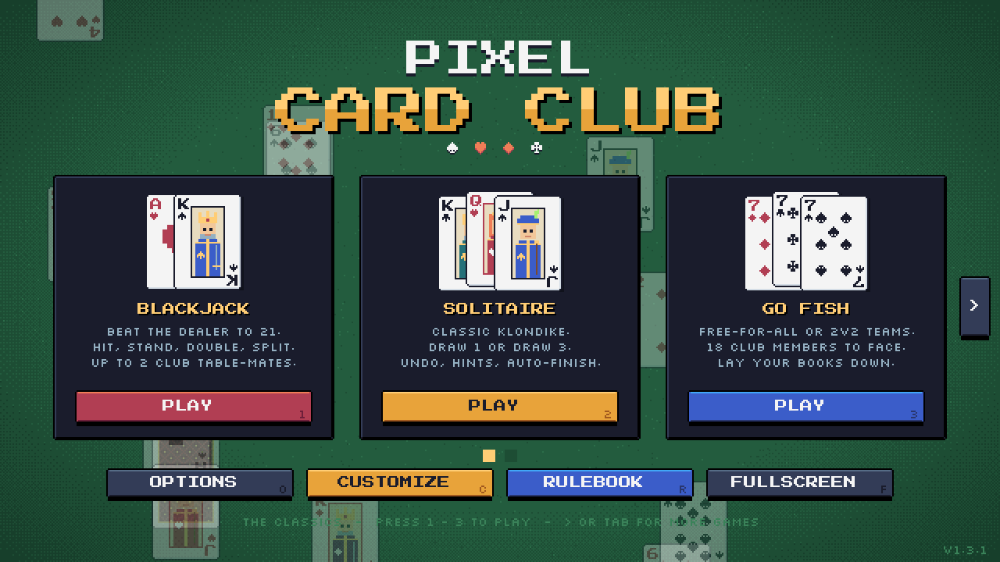 | 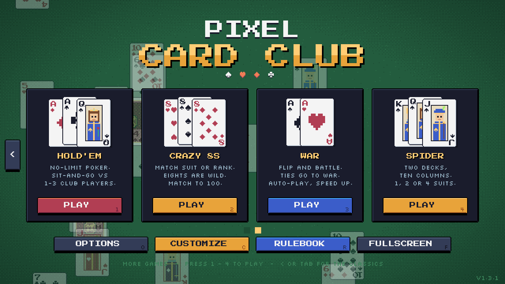 |

| Blackjack | Solitaire | Go Fish |
|---|---|---|
| 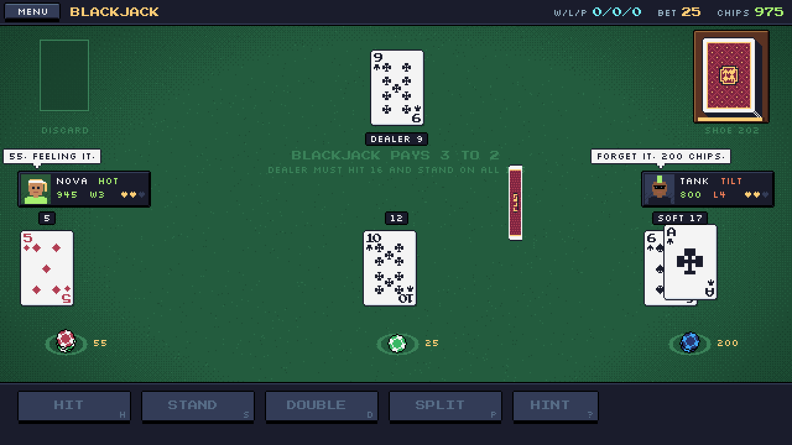 | 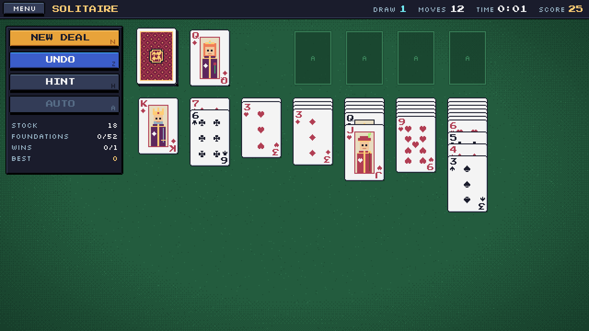 | 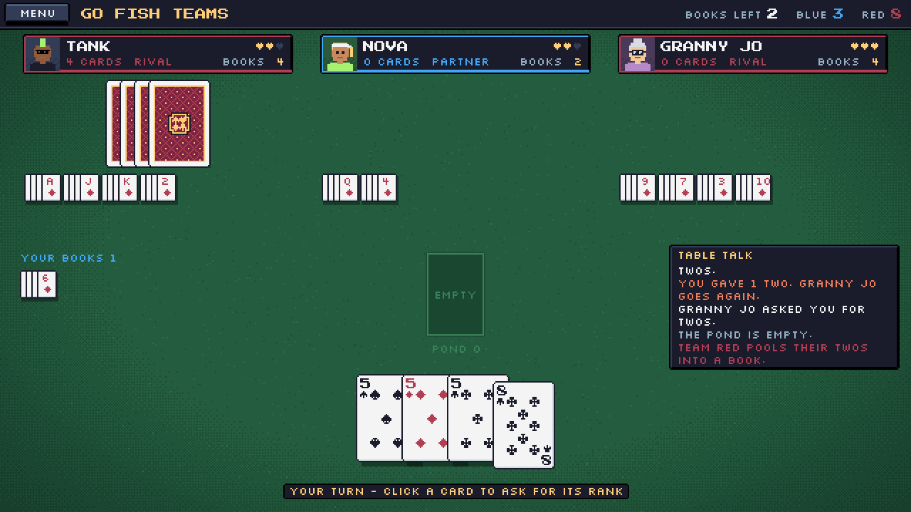 |

| Texas Hold'em | Spider | Crazy Eights |
|---|---|---|
| 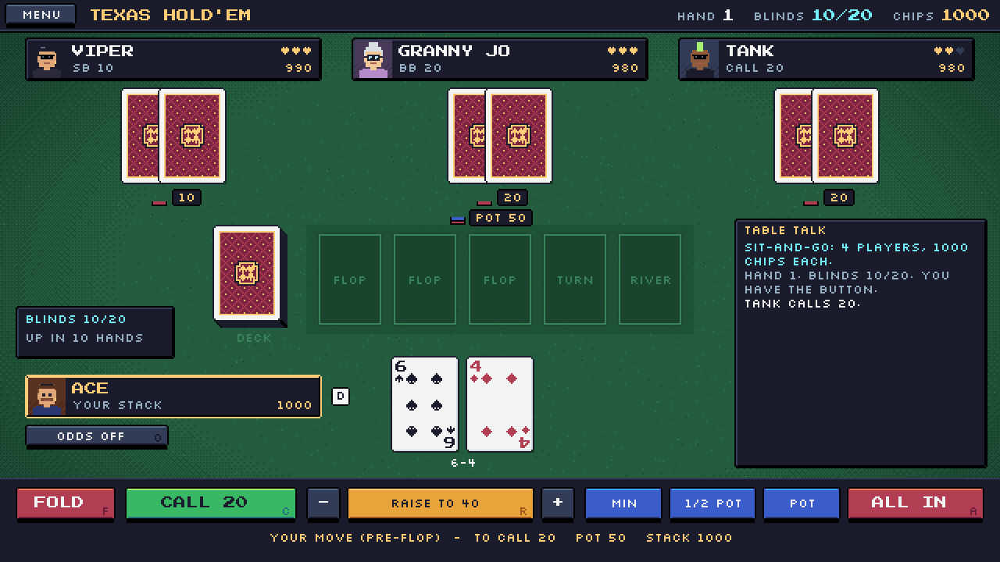 | 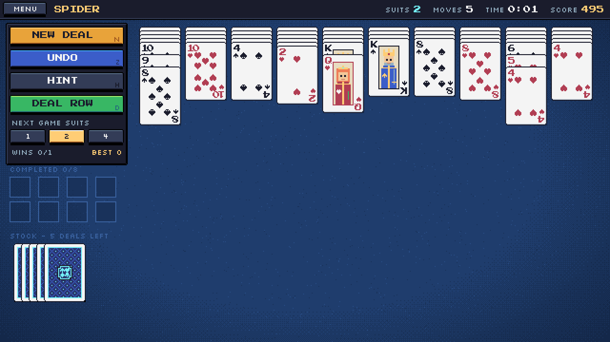 | 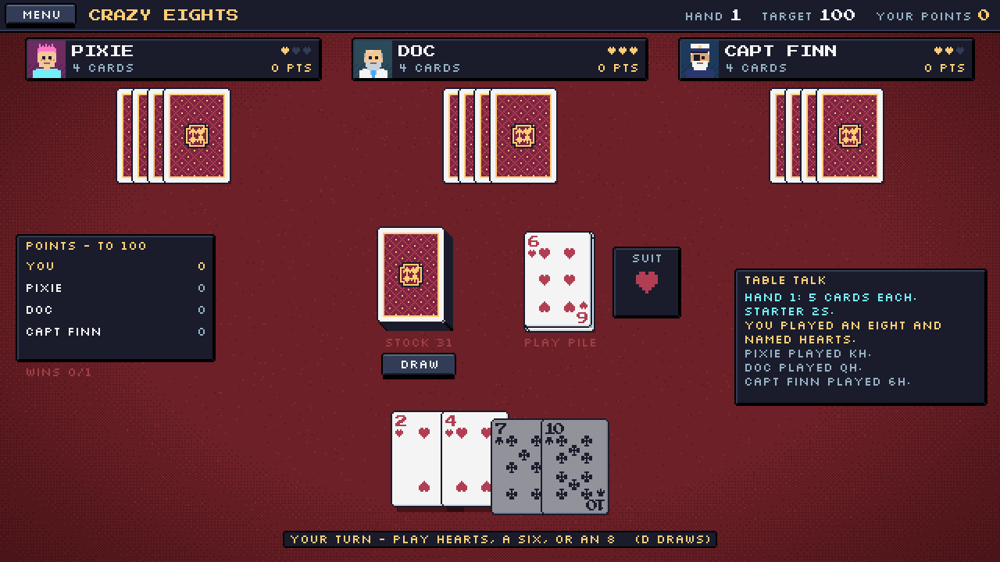 |

| War (Western Deck, brown table) | Customize menu | Western Deck |
|---|---|---|
| 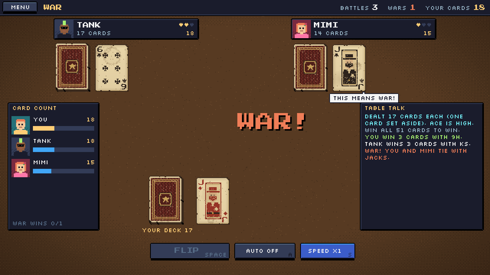 | 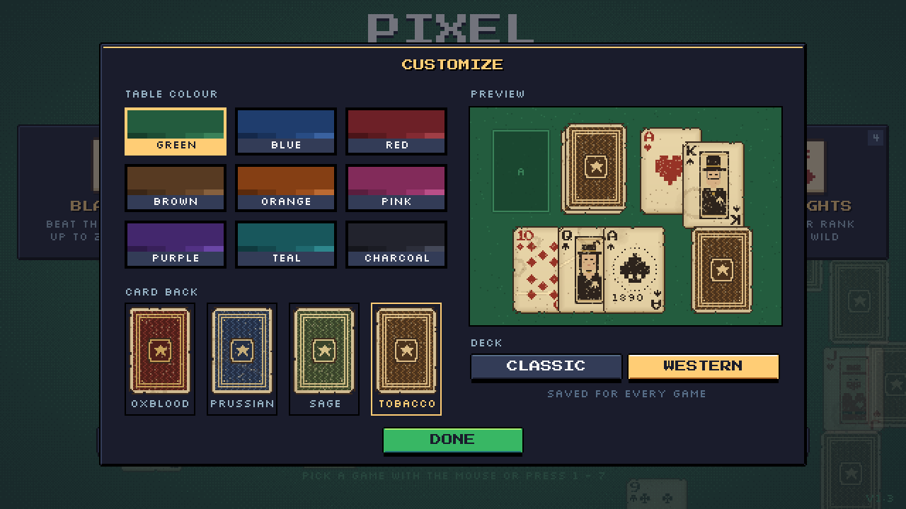 | 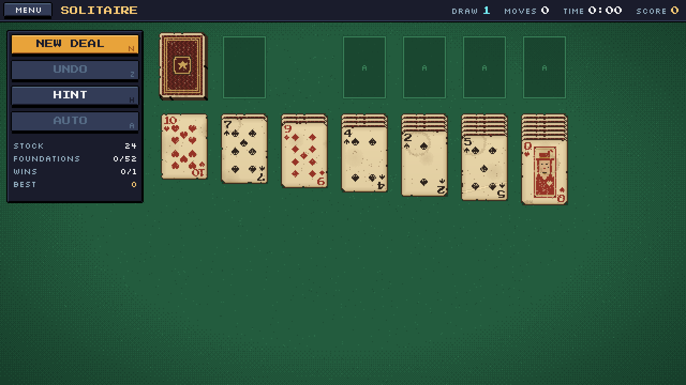 |

| Your profile |
|---|
| 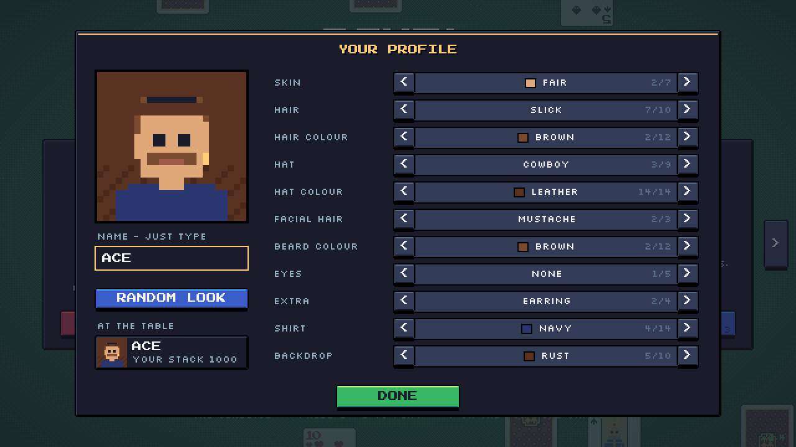 |

| The rulebook | The Club members | Choosing opponents |
|---|---|---|
| 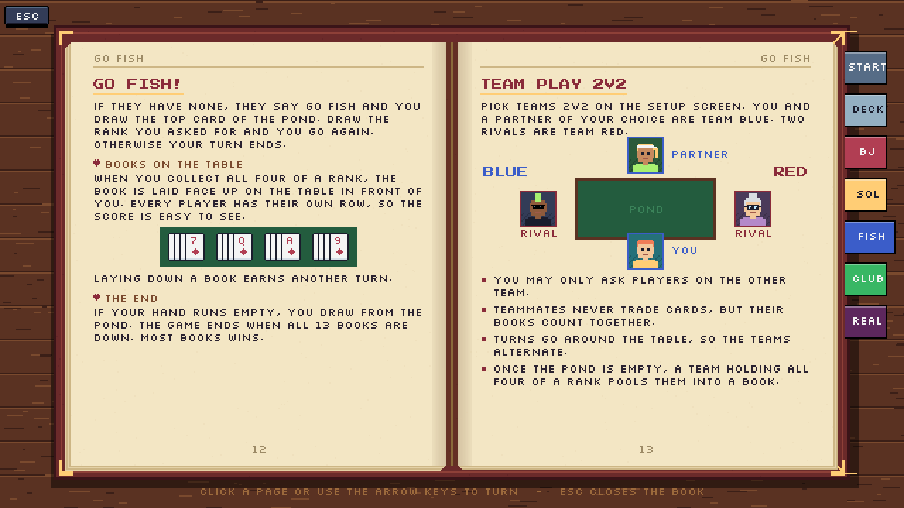 | 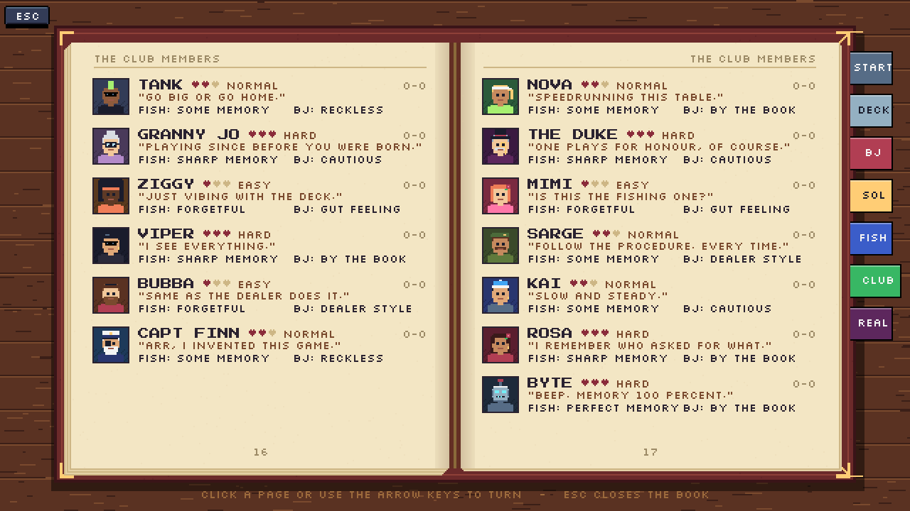 | 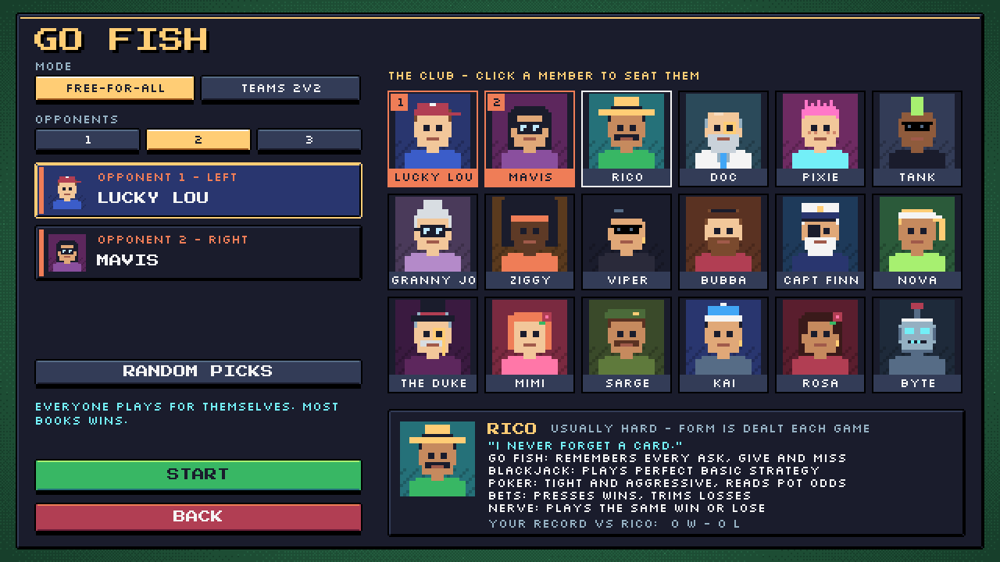 |

## What's new in 1.6.5

- iPhone / iPad: the game no longer shrinks when any keyboard opens, including the browser's own address bar. It keeps its full size behind the keyboard and is still the right size when the keyboard closes. Rotating the device and toolbars showing or hiding still resize it normally.

## What's new in 1.6.4

- **The web version now updates itself.** GitHub Pages lets browsers reuse files for up to 10 minutes, so a phone or tablet could keep opening an older version. The game now always asks for the newest files. When a new version is published, it reloads on its own: right away if you are on the main menu, or the next time you return to it, so a hand in progress is never cut off.
- Links with extra tags on the end (such as `?utm_source=...`) open the same up-to-date game and still work offline.
- Releasing: the version number lives in `package.json`, `app/version.json` and `G.VERSION` in `app/js/main.js`.

## What's new in 1.6.3

- Typing your name on iPhone / iPad: the game no longer shrinks when the on-screen keyboard opens. It keeps its size and slides up just enough to keep the name box above the keyboard.
- When the keyboard closes, the game returns to full screen right away, instead of staying the wrong size until you refresh.
- The keyboard's return key reads Done, and the browser's password and address suggestions no longer appear over the name box (where the browser allows it).

## What's new in 1.6.2

- **No more border in the PC browser or the desktop app.** Fill window is now the default screen mode, and it fills the whole window at any size or shape. The game stays centred, and the table, top bar and bottom controls stretch into the extra space. Saves from older versions switch to Fill window once. You can still pick Pixel perfect in Options for perfectly even pixels with a border.

## What's new in 1.6.1

- **Fills the whole screen on iPad and iPhone.** The game no longer shows black bars when the screen is not widescreen, such as an iPad, or a phone or tablet browser with its address bar showing. The table, top bar, bottom controls and the rulebook desk now stretch into the extra space, and the game stays centred. This works in Safari, Chrome and Firefox, and in the Home Screen app.

## What's new in 1.6.0

- **Play on iPhone and iPad.** The game is now hosted on GitHub Pages and works as a touch game. Add it to your Home Screen and it opens full screen like an app (see [Play on iPhone / iPad](#play-on-iphone--ipad)).
- Touch controls: tap anything you would click. The keyboard hints on the buttons are hidden on touch screens, and on-screen hints say TAP instead of CLICK.
- Tap the name box in Your profile to type your name with the on-screen keyboard.
- The picture scales to fill the screen on phones and tablets, and a "turn your device sideways" screen appears in portrait.
- Progress in the browser and on iPhone / iPad is now saved on the device, so chips, wins and settings carry over between visits.
- It works offline after the first visit.

## What's new in 1.5.0

- **Watch to the end** (Options > WHEN YOU ARE OUT): when you are knocked out, keep watching the Club finish the game and see who wins.
  - Hold'em: the remaining players play on at double pace until one holds every chip.
  - War: the rest flip on auto at speed x3 until one player holds every card.
  - Blackjack: when you run out of chips, your table-mates play up to 20 more hands with no rebuys. The one with the most chips wins the table, then you can take a fresh stack and sit back in.
  - **K** or **SKIP TO RESULT** jumps straight to the standings.
- Floating payout text (+15, -25, PUSH, BUST) now stays in open felt, so it never drifts over a name plate or a result tag.
- Crazy Eights: the suit picker explains that the next player must follow the suit you name, and shows how many of each suit you hold.
- Hold'em: your plate shows your finishing place once you are out.

## What's new in 1.4.3

- Blackjack: table-mate plates are a touch wider. Form hearts now sit next to the name, and the mood tag (HOT, COLD, ON FIRE, DOWN BAD and so on) moved down beside the chip count, so long names like CAPT FINN or GRANNY JO no longer collide with it. When there is no mood, the win/loss streak shows in that spot.

## What's new in 1.4.2

- War: your deck and its card count sit a little higher, so the "YOUR DECK" label no longer hides under the flip hint.
- Blackjack: the "BLACKJACK PAYS 3 TO 2" table print fades away once cards are dealt, so the dealer total and result banners never sit on top of it.

## What's new in 1.4.1

- Your speech bubble now pops up above your own seat plate instead of over your cards (Go Fish and Crazy Eights).
- Every speech bubble, yours and the Club members', stays on screen about a second longer.

## What's new in 1.4

- **Form is dealt each game**: Club members no longer show fixed hearts. Each game, every member at the table gets hearts for their form that game, rolled from their usual level, so a shark can have an off night and an easy player can get hot. The AI plays to its form.
- **Your own profile**: press **P** (or click your badge on the main menu) to set your name and build your portrait: skin, hair, hat, facial hair, glasses, extras, shirt and backdrop. You now have a seat plate at every Club table.

## What's new in 1.3.1

- **Two-page main menu**: the three classics (Blackjack, Solitaire, Go Fish) are back on the first page with the 1.2 layout, and the newer games are on a second page.

## What's new in 1.3

- **Four new games**: Texas Hold'em, Spider Solitaire, Crazy Eights and War, each with its own HUD and Club opponents.
- **Customize menu** (press **C**): nine table colours (Green, Blue, Red, Brown, Orange, Pink, Purple, Teal, Charcoal), card backs and a choice of deck.
- **The Western Deck**: a worn 1890s deck with yellowed stock, coffee stains, faded ink and nicked corners. The court cards are an outlaw, a saloon queen and a cattle baron in wanted-poster frames, and the backs have a sheriff-star medallion.
- **Bigger rulebook**: new chapters for every new game, poker styles for every Club member, and a sources section listing the published rules each game is based on.

## What's new in 1.2

- **Blackjack table-mates have moods.** Their bets rise and fall with their streak and stack, their play gets riskier or safer depending on their nerve, and they comment on it as the session goes ("THIS SUCKS." on a cold run, cheering on a hot one). Their panel shows their streak and mood.

## What's new in 1.1

- **Rulebook**: press **R** on the main menu (or **Esc → How to Play** in any game). It's drawn as a leather book with chapter tabs, and pages turn with an animation.
- **The Club**: 18 computer players, each with a pixel portrait, a usual skill level, a Go Fish habit, a Blackjack style and their own lines. Their win/loss record against you is saved.
- **Go Fish teams (2v2)**: pick a partner and two rivals. Team books are counted together.
- **Books on the table**: every completed Go Fish book is laid face up in front of the player who made it.
- **Blackjack table-mates**: up to 2 Club members sit at the table and play their own hands.
- Solitaire fixes: the hint outline on the stock is centred, and it clears as soon as you start dragging.

## Download and play (Windows)

1. Open the [**Releases**](../../releases) page.
2. Download one of:
   - `PixelCardClub-x.y.z-portable.exe`: a single file. Double-click to play; no install needed.
   - `Pixel.Card.Club.Setup.x.y.z.exe`: a normal installer with Start-menu and desktop shortcuts.
3. Windows SmartScreen may warn about an unknown publisher, because the app isn't code-signed. Click **More info → Run anyway**.

Your chips, wins, best scores and settings are saved automatically to `%APPDATA%\Pixel Card Club\save.json`.

## Play on iPhone / iPad

1. Open **[https://bloodrive65.github.io/pixel-card-club/](https://bloodrive65.github.io/pixel-card-club/)** in **Safari**.
2. Tap the **Share** button, then **Add to Home Screen**. Leave **Open as Web App** turned on, then tap **Add** ([Apple's guide](https://support.apple.com/guide/iphone/open-as-web-app-iphea86e5236/ios)).
3. Open **Card Club** from your Home Screen and turn the device sideways. It runs full screen, with no Safari bars.

Tap anything you would click. In Solitaire and Spider you can drag cards with your finger or tap a card to move it. Progress is saved on the device. If you remove the Home Screen icon, that saved progress may be removed too. Updates arrive automatically the next time you open it with an internet connection.

### Play in a browser instead

Open the [web version](https://bloodrive65.github.io/pixel-card-club/) in any modern browser, or open `app/index.html` from a download of this repo. Progress is saved in that browser on that computer.

## Controls at a glance

| Where | Key / mouse | Action |
|---|---|---|
| Everywhere | **Mouse** | Everything is clickable |
| Everywhere | **Esc** | Pause menu: Resume, How to Play, New Game, Main Menu |
| Everywhere | **F11** | Toggle fullscreen (desktop app) |
| Main menu | **← / →** or **Tab** | Switch between The Classics and More Games |
| Main menu | **1–3** / **1–4** | Classics: Blackjack, Solitaire, Go Fish. More Games: Hold'em, Crazy Eights, War, Spider |
| Main menu | **O / C / P** | Options / Customize / Your profile |
| Main menu | **R** | Open the rulebook |
| Rulebook | **← / →**, click a page, **Esc** | Turn pages, close the book |
| Blackjack | **T** | Choose table-mates (between rounds) |
| Blackjack | **1–4**, **C**, **A**, **Space** | Add 5/25/100/500 chips, clear the bet, all in, deal |
| Blackjack | **H S D P ?** | Hit, Stand, Double, Split, Hint |
| Hold'em | **F C R A O**, **− / +** | Fold, Check/Call, Bet/Raise, All in, Odds helper; change the raise size |
| Solitaire | **N Z H A** | New deal, Undo, Hint, Auto-finish |
| Spider | **N Z H D** | New deal, Undo, Hint, Deal a row |
| Crazy Eights | **D**, **P**, **1–4** | Draw, Pass, pick a suit after an 8 |
| War | **Space A S** | Flip, Auto-flip, Speed |
| Go Fish | **Left click / right click** | Choose a card, then a player / cancel the selection |

Full rules and strategy for every mode are in [**docs/HOW_TO_PLAY.md**](docs/HOW_TO_PLAY.md). The same rules are in the in-game rulebook. The published rules each game is based on, and where Pixel Card Club differs, are listed in [**docs/RULES_SOURCES.md**](docs/RULES_SOURCES.md).

## Customize

- **Table colour**: nine felt colours, used on every table and menu.
- **Deck**: Classic or Western.
- **Card back**: four per deck (Classic: Crimson, Cobalt, Forest, Royal. Western: Oxblood, Prussian, Sage, Tobacco).

## Options

- **Sound**: on or off. All sounds are generated live, so there are no audio files.
- **Scaling**: **Fill window** (the default) scales the game to the window and stretches the table, top bar and bottom controls into any extra space, so there is no border. **Pixel perfect** scales the 640×360 image by whole numbers only (2×, 3×, 4×…) for perfectly even pixels, but leaves a dark border when the window size isn't an exact multiple. Phones and tablets always use Fill window.
- **Solitaire draw**: draw 1 or draw 3.
- **Blackjack decks**: 1, 2, 4 or 6 decks in the shoe.
- **When you are out**: *Stop* (default) ends the game the moment you are knocked out. *Watch to the end* lets the Club play on so you can see who wins. It works in Hold'em, War and Blackjack (with table-mates seated). You get nothing for it; it is just for fun. Press **K** or **SKIP TO RESULT** to jump to the final standings.
- **Reset chips + wins**: clears saved stats, Club records and table-mates' chips.

## Using your own card art

The built-in deck is drawn in code, but you can drop in any pixel-art sprite sheet, such as [Art_Bickles' Pixel Playing Cards](https://art-bickles.itch.io/playing-cards) or [drawsgood's 8Bit Deck](https://drawsgood.itch.io/8bit-deck-card-assets). See [**docs/CUSTOM_CARDS.md**](docs/CUSTOM_CARDS.md). Please follow each artist's license, and don't commit paid assets to a public repo.

## Building from source

```bash
npm install
npm start            # run the desktop app
npm run dist:win     # build the Windows installer and portable .exe into release/
```

Full details, including automatic GitHub releases, are in [**docs/BUILDING.md**](docs/BUILDING.md). For how the code is put together, see [**docs/ARCHITECTURE.md**](docs/ARCHITECTURE.md).

## Project layout

```
app/                  the game itself (plain HTML5 canvas + JavaScript, no frameworks)
  index.html
  manifest.webmanifest, sw.js, icon-*.png   Home Screen app (iPhone / iPad) and offline support
  version.json        current version, checked by the web version to update itself
  js/engine.js        canvas scaling, input, bitmap text, chiptune audio, save storage
  js/cards.js         card model, procedural pixel card art, deck styles, card animation
  js/western.js       the weathered 1890s Western Deck
  js/ui.js            buttons, HUD bar, dialogs, pause and rules menus, felt table
  js/roster.js        the 18 Club members, pixel portraits, mini book cards, opponent picker
  js/table.js         shared kit for Hold'em, Crazy Eights and War (seats, talk, setup screen)
  js/rulebook.js      the in-game page-turning rulebook
  js/games/*.js       blackjack.js, holdem.js, solitaire.js, spider.js,
                      gofish.js, crazy8.js, war.js
  js/main.js          main menu, options, customize menu, scene manager, game loop
  assets/cards/       optional custom card sprite sheet (see docs/CUSTOM_CARDS.md)
electron/             desktop wrapper (window, fullscreen, save file)
docs/                 documentation and screenshots
.github/workflows/    automatic Windows build + release, and the GitHub Pages deploy
```

## Credits and license

- Code: MIT License (see [LICENSE](LICENSE)).
- Fonts: [Press Start 2P](https://fonts.google.com/specimen/Press+Start+2P) by CodeMan38 and [Silkscreen](https://fonts.google.com/specimen/Silkscreen) by Jason Kottke, both under the SIL Open Font License 1.1. They're baked into `app/js/font.js` as bitmap data.
- The Western Deck's look was inspired by [Nikoichu's Pixel Cards Premium](https://nikoichu.itch.io/pixel-cards-premium); all of its art is drawn in code and no assets are copied.
- Palette based on [Sweetie 16](https://lospec.com/palette-list/sweetie-16) by GrafxKid.
