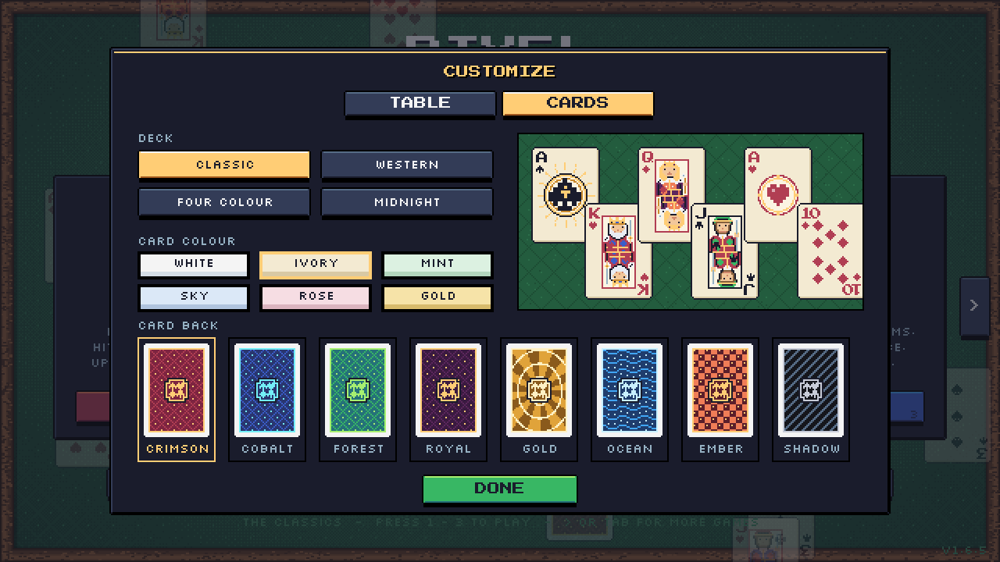
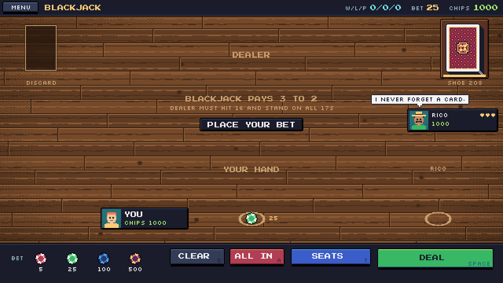

# Pixel Card Club

A 16-bit pixel-art card game collection for Windows, the browser, and iPhone / iPad (as a Home Screen web app).

**Play it in your browser or on your iPhone / iPad: [https://bloodrive65.github.io/pixel-card-club/](https://bloodrive65.github.io/pixel-card-club/)** It has seven classic games, each with its own HUD, animated cards and chiptune sound effects. A club of **18 computer players** fills the empty seats, and an in-game **rulebook** that you page through like a real book teaches every game.

| Game | Mode | Highlights |
|---|---|---|
| **Blackjack** | You vs the dealer, plus up to 2 Club table-mates | Hit, stand, double, split, 3:2 blackjacks, a 1–6 deck shoe, and a basic-strategy **advisor** |
| **Texas Hold'em** | No-limit sit-and-go vs 1–3 Club members | Rising or fixed blinds, side pots, an optional **odds helper**, and six AI poker styles (shark, LAG, rock, calling station, maniac, wild) |
| **Solitaire** | Klondike, solo | Draw 1 or 3, drag and drop or click-to-move, unlimited undo, hints, auto-finish, classic bouncing-card win screen |
| **Spider Solitaire** | Two decks, solo | 1, 2 or 4 suits, undo, hints, Windows-style scoring |
| **Go Fish** | Free-for-all vs 1–3 Club members, or **2v2 teams** with a partner you pick | Books are laid face up on the table, AI players that **remember** what others ask for, speech bubbles and a table-talk log |
| **Crazy Eights** | vs 1–3 Club members | Wild 8s with a suit picker, one hand or a match to 100 points, AI that tracks which suits you can't follow |
| **War** | vs 1–3 Club members | Multi-player wars, full game or one pass through the deck, auto-flip at up to 8× speed |

| The Classics | More Games |
|---|---|
|  |  |

| Blackjack | Solitaire | Go Fish |
|---|---|---|
|  |  |  |

| Texas Hold'em | Spider | Crazy Eights |
|---|---|---|
|  |  |  |

| War (Western Deck, brown table) | Customize menu | Western Deck |
|---|---|---|
|  |  |  |

| Your profile | Customize: cards | Wood table surface |
|---|---|---|
|  |  |  |

| The rulebook | The Club members | Choosing opponents |
|---|---|---|
|  |  |  |

## What's new in 1.7.3

- **Portrait and landscape on iPhone and iPad**: hold the device upright or sideways and the game re-lays itself to fit, even in the middle of a hand. In portrait, every game has its own tall table with the main buttons in easy thumb reach along the bottom. The menu, setup screens, profile, customize screen, options and rulebook have upright layouts too.
- **Sound with the ringer off**: on iPhone and iPad the game's sound now plays even when the Ring/Silent switch is set to silent, the same way video audio does. Use the volume buttons, or turn sound off in Options.
- Crazy Eights no longer shows the keyboard hint "(D DRAWS)" on touch screens.

Older versions are listed in [**CHANGELOG.md**](CHANGELOG.md).

## Download and play (Windows)

1. Open the [**Releases**](../../releases) page.
2. Download one of:
   - `PixelCardClub-x.y.z-portable.exe`: a single file. Double-click to play; no install needed.
   - `Pixel.Card.Club.Setup.x.y.z.exe`: a normal installer with Start-menu and desktop shortcuts.
3. Windows SmartScreen may warn about an unknown publisher, because the app isn't code-signed. Click **More info → Run anyway**.

Your chips, wins, best scores and settings are saved automatically to `%APPDATA%\Pixel Card Club\save.json`.

## Play on iPhone / iPad

1. Open **[https://bloodrive65.github.io/pixel-card-club/](https://bloodrive65.github.io/pixel-card-club/)** in **Safari**.
2. Tap the **Share** button, then **Add to Home Screen**. Leave **Open as Web App** turned on, then tap **Add** ([Apple's guide](https://support.apple.com/guide/iphone/open-as-web-app-iphea86e5236/ios)).
3. Open **Card Club** from your Home Screen. It runs full screen, with no Safari bars, and you can hold it upright (portrait) or sideways (landscape).

Tap anything you would click. In Solitaire and Spider you can drag cards with your finger or tap a card to move it. Progress is saved on the device. If you remove the Home Screen icon, that saved progress may be removed too. Updates arrive automatically the next time you open it with an internet connection.

### Play in a browser instead

Open the [web version](https://bloodrive65.github.io/pixel-card-club/) in any modern browser, or open `app/index.html` from a download of this repo. Progress is saved in that browser on that computer.

## Controls at a glance

| Where | Key / mouse | Action |
|---|---|---|
| Everywhere | **Mouse** | Everything is clickable |
| Everywhere | **Esc** | Pause menu: Resume, How to Play, New Game, Main Menu |
| Everywhere | **F11** | Toggle fullscreen (desktop app) |
| Main menu | **← / →** or **Tab** | Switch between The Classics and More Games |
| Main menu | **1–3** / **1–4** | Classics: Blackjack, Solitaire, Go Fish. More Games: Hold'em, Crazy Eights, War, Spider |
| Main menu | **O / C / P** | Options / Customize / Your profile |
| Main menu | **R** | Open the rulebook |
| Rulebook | **← / →**, click a page, **Esc** | Turn pages, close the book |
| Blackjack | **T** | Choose table-mates (between rounds) |
| Blackjack | **1–4**, **C**, **A**, **Space** | Add 5/25/100/500 chips, clear the bet, all in, deal |
| Blackjack | **H S D P ?** | Hit, Stand, Double, Split, Hint |
| Hold'em | **F C R A O**, **− / +** | Fold, Check/Call, Bet/Raise, All in, Odds helper; change the raise size |
| Solitaire | **N Z H A** | New deal, Undo, Hint, Auto-finish |
| Spider | **N Z H D** | New deal, Undo, Hint, Deal a row |
| Crazy Eights | **D**, **P**, **1–4** | Draw, Pass, pick a suit after an 8 |
| War | **Space A S** | Flip, Auto-flip, Speed |
| Go Fish | **Left click / right click** | Choose a card, then a player / cancel the selection |

Full rules and strategy for every mode are in [**docs/HOW_TO_PLAY.md**](docs/HOW_TO_PLAY.md). The same rules are in the in-game rulebook. The published rules each game is based on, and where Pixel Card Club differs, are listed in [**docs/RULES_SOURCES.md**](docs/RULES_SOURCES.md).

## Customize

Open **CUSTOMIZE** from the main menu. Everything is saved for every game.

- **TABLE tab**
  - **Table colour**: nine felt colours, used on every table and menu.
  - **Surface**: Felt, Pattern, Wood Rail, Wood or Casino. Wood is a plank table and ignores the table colour.
- **CARDS tab**
  - **Deck**: Classic, Western, Four Colour or Midnight.
  - **Card colour**: White, Ivory, Mint, Sky, Rose or Gold (Classic and Four Colour decks).
  - **Card back**: eight for Classic, Four Colour and Midnight (Crimson, Cobalt, Forest, Royal, Gold, Ocean, Ember, Shadow) and four for Western (Oxblood, Prussian, Sage, Tobacco).

## Options

- **Sound**: on or off. All sounds are generated live, so there are no audio files.
- **Scaling**: **Fill window** (the default) scales the game to the window and stretches the table, top bar and bottom controls into any extra space, so there is no border. **Pixel perfect** scales the 640×360 image by whole numbers only (2×, 3×, 4×…) for perfectly even pixels, but leaves a dark border when the window size isn't an exact multiple. Phones and tablets always use Fill window.
- **Solitaire draw**: draw 1 or draw 3.
- **Blackjack decks**: 1, 2, 4 or 6 decks in the shoe.
- **When you are out**: *Stop* (default) ends the game the moment you are knocked out. *Watch to the end* lets the Club play on so you can see who wins. It works in Hold'em, War and Blackjack (with table-mates seated). You get nothing for it; it is just for fun. Press **K** or **SKIP TO RESULT** to jump to the final standings.
- **Reset chips + wins**: clears saved stats, Club records and table-mates' chips.

## Using your own card art

The built-in deck is drawn in code, but you can drop in any pixel-art sprite sheet, such as [Art_Bickles' Pixel Playing Cards](https://art-bickles.itch.io/playing-cards) or [drawsgood's 8Bit Deck](https://drawsgood.itch.io/8bit-deck-card-assets). See [**docs/CUSTOM_CARDS.md**](docs/CUSTOM_CARDS.md). Please follow each artist's license, and don't commit paid assets to a public repo.

## Building from source

```bash
npm install
npm start            # run the desktop app
npm run dist:win     # build the Windows installer and portable .exe into release/
```

Full details, including automatic GitHub releases, are in [**docs/BUILDING.md**](docs/BUILDING.md). For how the code is put together, see [**docs/ARCHITECTURE.md**](docs/ARCHITECTURE.md).

## Project layout

```
app/                  the game itself (plain HTML5 canvas + JavaScript, no frameworks)
  index.html
  manifest.webmanifest, sw.js, icon-*.png   Home Screen app (iPhone / iPad) and offline support
  version.json        current version, checked by the web version to update itself
  js/engine.js        canvas scaling, input, bitmap text, chiptune audio, save storage
  js/cards.js         card model, procedural pixel card art, deck styles, card animation
  js/western.js       the weathered 1890s Western Deck
  js/decks.js         the Four Colour and Midnight decks
  js/ui.js            buttons, HUD bar, dialogs, pause and rules menus, felt table
  js/roster.js        the 18 Club members, pixel portraits, mini book cards, opponent picker
  js/table.js         shared kit for Hold'em, Crazy Eights and War (seats, talk, setup screen)
  js/rulebook.js      the in-game page-turning rulebook
  js/games/*.js       blackjack.js, holdem.js, solitaire.js, spider.js,
                      gofish.js, crazy8.js, war.js
  js/main.js          main menu, options, customize menu, scene manager, game loop
  assets/brand/       the bloodrive65 splash-screen logo
  assets/cards/       optional custom card sprite sheet (see docs/CUSTOM_CARDS.md)
electron/             desktop wrapper (window, fullscreen, save file)
docs/                 documentation and screenshots
.github/workflows/    automatic Windows build + release, and the GitHub Pages deploy
```

## Credits and license

- Code: MIT License (see [LICENSE](LICENSE)).
- Fonts: [Press Start 2P](https://fonts.google.com/specimen/Press+Start+2P) by CodeMan38 and [Silkscreen](https://fonts.google.com/specimen/Silkscreen) by Jason Kottke, both under the SIL Open Font License 1.1. They're baked into `app/js/font.js` as bitmap data.
- The Western Deck's look was inspired by [Nikoichu's Pixel Cards Premium](https://nikoichu.itch.io/pixel-cards-premium); all of its art is drawn in code and no assets are copied.
- Palette based on [Sweetie 16](https://lospec.com/palette-list/sweetie-16) by GrafxKid.
